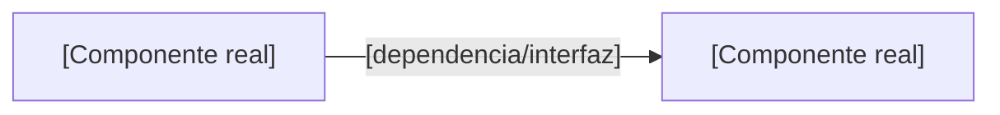
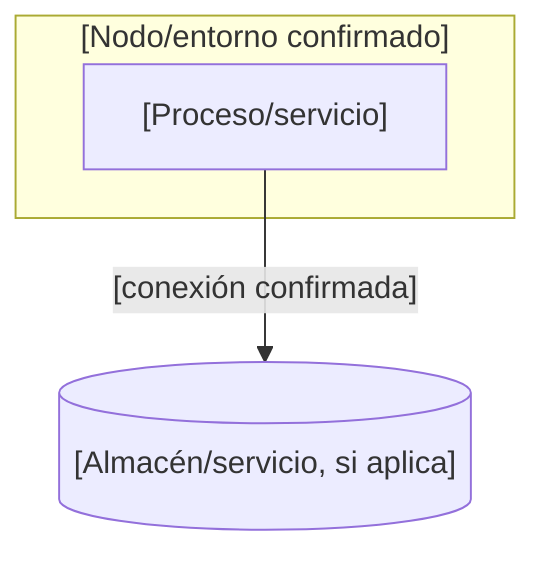
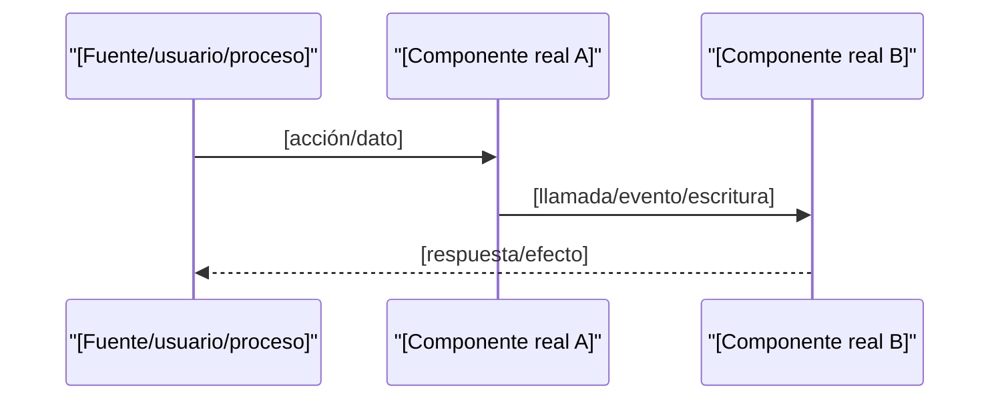

# Avance del sábado · propuesta de mejora y arquitectura inicial

> **Objetivo:** dejar listo un cambio pequeño y verificable para implementar la próxima semana. No se espera entregar aquí la mejora terminada. Llena los campos con datos del repositorio y marca como `PENDIENTE` lo que todavía no hayas podido confirmar.

## 1. Identificación y estado de partida

| Dato | Información |
|---|---|
| Nombre |  Diego Ignacio Garcia Diaz de Leon|
| Grupo/equipo | [Datos] |
| Repositorio/ruta de trabajo | https://github.com/EldiegoGDL/Implementaci-n-de-Lambda |
| Rama y commit inicial | Agente "incorporacion del agente" |
| Sistema operativo y versión | windows 10 version 22H2 |
| Agente y forma de acceso |GitHub Copilot local
| Cambios locales previos a conservar | kit_Lambda_LLM para orientacion y seguimiento de la implementacion |

## 2. Arquitectura actual antes del cambio

Los diagramas representan lo que encontraste en este commit. Marca pendientes e inferencias; no dibujes una arquitectura futura como si ya existiera.

### Vista estática · módulos, responsabilidades e interfaces

**Evidencia en archivos/funciones:** [Rutas, nombres y explicación breve.]  
**Pendientes:** [Elementos por confirmar y cómo hacerlo.]

### Vista física · entornos y despliegue

**Dónde se ejecuta cada elemento y evidencia:** [Anfitrión, contenedor, servicio externo u otro; versiones conocidas.]  
**Pendientes:** [Elementos por confirmar.]

### Vista dinámica · recorrido de un escenario existente

**Escenario:** [Por ejemplo, desde la entrada de una muestra hasta el resultado o consulta.]  
**Resultado esperado:** [Qué debería ocurrir según código/documentación.]

**Evidencia y resultado observado:** [Código, comando, log o salida.]  
**Pendientes:** [Lo que todavía no se pudo comprobar.]

## 3. Problema o oportunidad

- **Necesidad concreta:** [Qué se quiere mejorar.]  
- **Evidencia observada:** [Error reproducible, comportamiento, tarea repetida o limitación con referencia a archivo/comando/entorno.]  
- **A quién o qué beneficia:** [Persona, proceso o atributo de calidad.]  
- **Por qué importa para este proyecto:** [Una o dos frases.]  
- **Tipo:** [Portabilidad / funcionalidad / configuración / pruebas / observabilidad / documentación ejecutable / otra.]  

## 4. Propuesta de mejora pequeña

- **Qué sí se cambiará:** [Alcance concreto.]  
- **Qué queda fuera:** [Exclusiones explícitas.]  
- **Archivos o componentes que podrían cambiar:** [Rutas, si se conocen.]  
- **Interfaces, formatos o responsabilidades que se deben conservar:** [Solo los confirmados.]  
- **Efecto previsto en la vista estática:** [Cambio/no cambio y razón.]  
- **Efecto previsto en la vista física:** [Cambio/no cambio y razón.]  
- **Efecto previsto en la vista dinámica:** [Cambio/no cambio y razón.]  
- **Riesgo principal y cómo reducirlo:** [Respuesta.]  

### Criterios de aceptación y comprobación

| Criterio observable | Cómo se comprobará | Entorno requerido | Resultado esperado |
|---|---|---|---|
| [Condición 1] | [Comando/prueba/pasos] | [SO/servicio/versión] | [Resultado] |
| [Condición 2] | [Comando/prueba/pasos] | [SO/servicio/versión] | [Resultado] |

## 5. Decisión y pendientes

- **Propuesta que acuerda implementar el equipo/estudiante:** [Descripción.]  
- **Motivo de la elección frente a alternativas:** [Razón propia, sustentada en la evidencia.]  
- **Pregunta que se resolverá antes de editar código:** [Si aplica.]  
- **Siguiente acción concreta para la semana 2:** [Acción.]  
- **Estimación personal de tiempo disponible:** [Horas aproximadas; permite acotar el alcance.]  

## 6. Revisión de este avance

- [ ] Confirmé rama, commit y cambios que no debo sobrescribir.
- [ ] Las vistas describen el sistema actual y tienen evidencia, o señalan claramente lo pendiente.
- [ ] El problema está sustentado y no es solamente una idea del agente.
- [ ] La propuesta cabe en el tiempo disponible y tiene exclusiones explícitas.
- [ ] Sé qué pruebas o comprobaciones usaré.
- [ ] Sé qué responsabilidades, interfaces o flujos deben preservarse.
