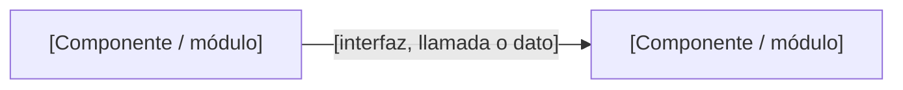
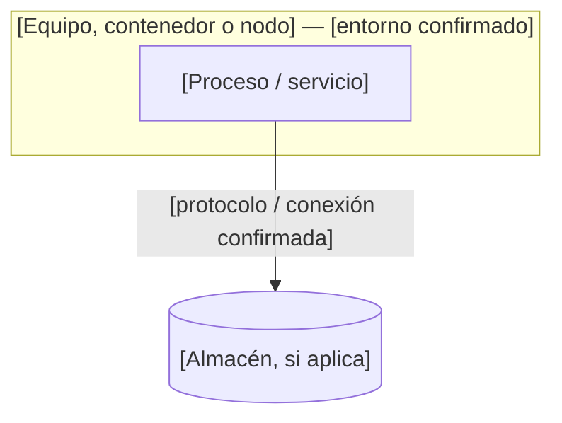
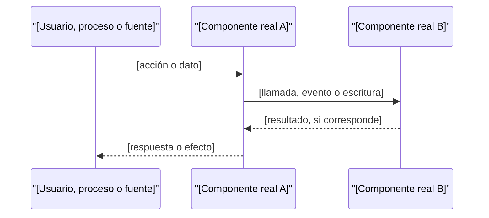

# Reporte individual de mejora arquitectónica con apoyo de un LLM

> **Cómo llenar este reporte:** conserva los encabezados y completa cada campo con información verificable. Puedes pedir a tu agente que prepare borradores o diagramas, pero debes revisar cada afirmación contra el repositorio y el entorno donde trabajaste. Sustituye las instrucciones entre corchetes. Si no tienes el dato o no pudiste probarlo, escribe `PENDIENTE` o `NO PROBADO` y explica por qué; no inventes resultados. Incluye diagramas Mermaid que se rendericen en GitHub o VS Code, o adjunta una imagen con su descripción textual.
>
> **Responsabilidad individual:** aunque el código o una propuesta se haya desarrollado en equipo, este archivo lo completa cada estudiante con su análisis personal. Usa el repositorio compartido como fuente, pero explica con tus palabras qué hace la mejora y cómo verificaste su efecto.

## 1. Datos de identificación y versión evaluada

| Dato | Información |
|---|---|
| Nombre de quien entrega | [Nombre completo] |
| Grupo y equipo, si aplica | [Grupo; equipo o individual] |
| Repositorio o copia evaluada | [URL o ruta] |
| Rama | [Rama] |
| Commit inicial | [SHA y fecha] |
| Commit final | [SHA y fecha] |
| Fecha de elaboración | [AAAA-MM-DD] |
| Agente/modelo y forma de acceso | [Nombre y versión si está visible; IDE, CLI u otro] |
| Sistema operativo usado | [Nombre y versión] |

## 2. Resumen ejecutivo

- **Necesidad o problema observado:** [Qué no funcionaba, faltaba o podía mejorarse.]
- **Mejora propuesta e implementada:** [Qué se hizo en una o dos frases.]
- **Resultado comprobado:** [Qué evidencia observaste; evita decir “funciona” sin indicar cómo lo sabes.]
- **Limitación más importante:** [Qué no resolviste o no pudiste probar.]

## 3. Estado inicial y alcance

### 3.1 Estado del proyecto antes de intervenir

- Commit y rama de partida: [Datos.]
- Cambios locales previos que se conservaron: [Archivos y propósito; escribe `NINGUNO` solo si se verificó.]
- Entorno donde se inspeccionó y ejecutó: [SO, versión de runtime, herramientas/servicios relevantes.]
- Comportamiento inicial que se observó: [Pasos, comando o evidencia.]

### 3.2 Alcance de la mejora

- **Problema y evidencia:** [Indica archivo, error, comportamiento o necesidad que motivó el cambio.]
- **Persona, proceso o calidad beneficiada:** [Quién se beneficia y de qué manera.]
- **Qué sí incluye:** [Límite concreto.]
- **Qué queda fuera:** [Elementos explícitamente no modificados.]
- **Criterios de aceptación definidos antes de implementar:**
  1. [Condición observable y cómo verificarla.]
  2. [Condición observable y cómo verificarla.]
  3. [Opcional.]

### 3.3 Decisión de diseño

| Alternativa considerada | Ventaja | Costo o riesgo | Decisión |
|---|---|---|---|
| [Alternativa A] | [ ] | [ ] | [Elegida/descartada y razón] |
| [Alternativa B] | [ ] | [ ] | [Elegida/descartada y razón] |

**Decisión final del estudiante/equipo:** [Qué se autorizó cambiar y por qué.]  
**Contratos o límites que se debían preservar:** [Responsabilidades, interfaces, formatos, persistencia, flujo batch/rápido, configuración o despliegue, según corresponda a esta versión. No incluyas elementos que no hayas confirmado.]

## 4. Arquitectura antes y después

Las tres vistas deben representar **la misma versión final** e identificar el commit final. Si la mejora no afecta alguna vista, conserva la vista comprobada y explica por qué no cambió. Distingue componentes existentes de propuestas futuras.

### 4.1 Vista estática: componentes y dependencias

**Qué debe mostrar:** módulos, componentes, procesos lógicos o capas; responsabilidades; dependencias o interfaces que participan en la mejora. Nombra los elementos como aparecen en el código. No agregues cajas genéricas que no correspondan a componentes comprobados.

| Elemento del diagrama | Responsabilidad observada | Archivo, función o configuración | Cambio realizado |
|---|---|---|---|
| [Nombre exacto] | [Qué hace] | [Ruta y símbolo] | [Sí/No; explicación] |

**Descripción y evidencia:** [Explica las relaciones principales y cómo las confirmaste en el código/configuración.]

### 4.2 Vista física: despliegue y entorno de ejecución

**Qué debe mostrar:** equipos o nodos, contenedores de despliegue cuando existan, procesos, servicios externos, almacenes, conexiones y puertos confirmados. Indica en qué sistema operativo y entorno probaste. No presentes una posibilidad como despliegue real.

| Nodo o entorno | Elementos que ejecuta/aloja | Tecnología y versión confirmadas | Evidencia o estado |
|---|---|---|---|
| [Nombre] | [Proceso/servicio] | [Tecnología, versión o `PENDIENTE`] | [Archivo, comando, salida] |

**Descripción, diferencias entre entornos y evidencia:** [Explica qué corre localmente, qué corre en contenedores o servicios remotos y qué no pudiste confirmar.]

### 4.3 Vista dinámica: escenario en tiempo de ejecución

**Escenario elegido:** [Describe una ejecución concreta: por ejemplo, una muestra que recorre la ruta existente hasta una consulta, o el uso de la funcionalidad que mejoraste.]  
**Resultado esperado:** [Qué respuesta o efecto se espera.]  
**Resultado observado:** [Qué sucedió realmente en la prueba.]

**Descripción y evidencia por paso:** [Vincula mensajes con código, logs o prueba. Señala errores, reintentos, asincronía o almacenamiento solo si aplican y fueron confirmados.]

### 4.4 Correspondencia y efecto de la mejora

| Elemento o relación modificada | Vista estática | Vista física | Vista dinámica | Evidencia en código/prueba |
|---|---|---|---|---|
| [Componente, nodo, interfaz o mensaje] | [Qué cambia / no cambia] | [Qué cambia / no cambia] | [Qué cambia / no cambia] | [Archivo, comando, resultado] |

**Coherencia entre las vistas:** [Confirma que los nombres y responsabilidades coinciden. Explica los casos en que un componente lógico corre en un entorno físico específico y en qué paso participa en el escenario.]  
**Pendientes o inferencias:** [Qué elemento no se pudo confirmar, qué se infiere y cómo se comprobaría.]

## 5. Implementación y cuidado de la arquitectura

### 5.1 Cambios realizados

| Archivo | Cambio realizado | Razón | Efecto arquitectónico esperado |
|---|---|---|---|
| [Ruta] | [Descripción concreta] | [Problema/criterio] | [Responsabilidad, interfaz, nodo o flujo afectado] |

- **Responsabilidad que se mantuvo o se reasignó:** [Explica.]
- **Interfaces/formato/configuración que se conservaron:** [Explica y cita evidencia.]
- **Cambios descartados por quedar fuera de alcance:** [Explica o `NINGUNO`.]
- **Revisión del diff:** [Quién/cuándo y qué se detectó o corrigió.]

### 5.2 Pruebas y comprobaciones

| Comando o paso reproducible | Entorno | Resultado esperado | Resultado observado | Evidencia/archivo | Estado |
|---|---|---|---|---|---|
| [Comando exacto desde el directorio indicado] | [SO, versiones y servicios] | [ ] | [ ] | [Ruta a log/captura/salida] | [PASA/FALLA/NO PROBADO] |

Separa pruebas automatizadas, comprobaciones manuales y pruebas de integración con infraestructura. Una prueba unitaria o un doble de prueba no demuestra que un servicio real estuvo disponible.

### 5.3 Portabilidad y diferencias entre sistemas operativos

Completa esta sección si hubo un problema o una propuesta de compatibilidad. Si no aplica, escribe `No se realizaron cambios de portabilidad` y explica qué entorno sí se probó.

- **Problema reproducible:** [Síntoma, SO, versión, comando, error observado.]
- **Causa confirmada o hipótesis:** [Distingue ambas.]
- **Ajuste realizado:** [Archivo y cambio mínimo.]
- **Sistemas/entornos probados:** [Registra versiones y resultado; `NO PROBADO` si aplica.]
- **Límite de la afirmación de compatibilidad:** [Qué no se verificó.]

| Entorno probado | Versión | Comando/caso | Resultado | Evidencia |
|---|---|---|---|---|
| [Sistema operativo] | [Versión] | [ ] | [PASA/FALLA/NO PROBADO] | [ ] |

## 6. Uso del agente de LLM

Describe el proceso con transparencia, sin pegar una conversación extensa ni atribuirte automáticamente contenido generado por el agente.

| Tarea solicitada | Qué contexto/instrucción le diste | Qué generó o modificó | Qué verificaste y qué corregiste |
|---|---|---|---|
| [Exploración, diseño, código, revisión o documentación] | [Resumen; cita archivo de contexto si ayuda] | [Resultado] | [Comprobación/revisión] |

- **Una sugerencia del agente que acepté:** [Y por qué.]  
- **Una sugerencia que adapté o rechacé:** [Y por qué.]  
- **Cómo comprobé que el agente trabajó sobre mi repositorio y versión:** [Evidencia.]  
- **Información que no se compartió con el agente:** [Secretos/datos excluidos o `NO APLICA` con motivo.]

## 7. Reflexión individual

Responde con ejemplos de tu trabajo, no con frases generales:

1. ¿Qué entendiste sobre la arquitectura que no tenías claro antes? [Respuesta.]
2. ¿Qué decisión de diseño tomaste o defendiste personalmente? [Decisión y fundamento.]
3. ¿Qué evidencia te permite decir que la mejora funciona o qué te impide afirmarlo todavía? [Respuesta.]
4. ¿Qué límite o riesgo arquitectónico revisarías en una siguiente iteración? [Respuesta.]
5. ¿Qué harías distinto al trabajar con un agente la próxima vez? [Respuesta.]

## 8. Reproducción y archivos de entrega

Indica instrucciones probadas para que otra persona reproduzca la comprobación principal. No incluyas credenciales ni secretos.

1. [Prerrequisitos y versiones.]  
2. [Preparación/configuración con valores de ejemplo seguros.]  
3. [Directorio y comando exactos.]  
4. [Señal que indica el resultado esperado.]  
5. [Cómo detener o limpiar la ejecución, si aplica.]  
6. [Límites o pasos que no se pudieron reproducir.]  

### Lista de archivos enlazados

- [Código o diff relevante](ruta relativa)
- [Propuesta/decisión](ruta relativa)
- [Pruebas y evidencias](ruta relativa)
- [Contexto/arquitectura](ruta relativa)
- [Commit final](SHA)

## 9. Lista de revisión antes de entregar

- [ ] El reporte identifica el commit final y el entorno realmente usado.
- [ ] La vista estática muestra responsabilidades y dependencias rastreables al código.
- [ ] La vista física separa los nodos/entornos reales y no confunde componente con contenedor Docker.
- [ ] La vista dinámica explica un escenario observable en tiempo de ejecución.
- [ ] Las tres vistas describen la misma versión y usan nombres coherentes.
- [ ] Cada caja y relación importante tiene evidencia o está marcada como pendiente/inferencia.
- [ ] La mejora y sus exclusiones están delimitadas.
- [ ] Los criterios de aceptación se relacionan con pruebas ejecutadas.
- [ ] Los resultados no probados y las limitaciones se declaran claramente.
- [ ] Los cambios previos del repositorio se conservaron y los cambios propios se identifican.
- [ ] Revisé personalmente los diagramas, el diff, las pruebas y las conclusiones.
- [ ] El reporte incluye mi análisis individual aunque la implementación sea compartida.
