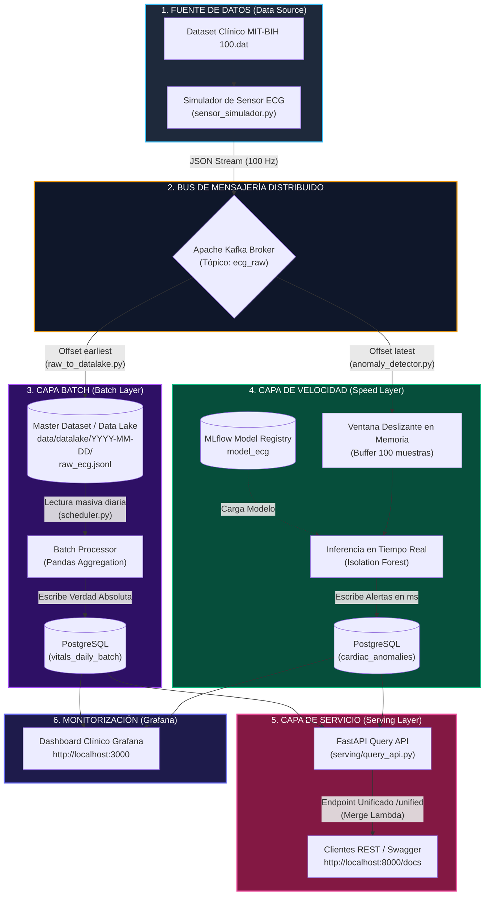

# 01. Fundamentos de la Arquitectura Lambda

Este documento detalla los principios teóricos, matemáticos y de diseño de sistemas distribuidos que fundamentan el proyecto **Medical IoT**.

---

## 1. El Problema Fundamental del Procesamiento Masivo de Datos

En sistemas de telemetría biomédica y flujos de eventos a gran escala (*Big Data*), los arquitectos de software se enfrentan a un dilema clásico entre **latencia** y **precisión**:

1. **Si solo usamos procesamiento por lotes (Batch puro):**
   - Garantiza alta precisión, cálculo determinista y posibilidad de reprocesar el historial completo si la lógica de negocio cambia.
   - **Desventaja fatal en medicina:** Las consultas tienen una latencia de minutos u horas. Un paciente con paro cardíaco o taquicardia ventricular moriría antes de que el lote termine de procesarse.
2. **Si solo usamos procesamiento en tiempo real (Streaming puro):**
   - Proporciona latencia de pocos milisegundos para emitir alarmas inmediatas.
   - **Desventaja fatal en auditoría clínica:** Los motores en memoria pueden perder eventos ante caídas de red, acumular deriva estadística (*drift*) o ser incapaces de recalcular retrospectivamente el historial si se refina un algoritmo diagnóstico meses después.

---

## 2. La Solución: La Arquitectura Lambda (Nathan Marz, 2011)

Diseñada por **Nathan Marz** (creador de Apache Storm), la **Arquitectura Lambda** resuelve este dilema dividiendo el procesamiento en dos capas paralelas y complementarias que convergen en una capa de servicio unificada.

### La Ecuación Universal de Consulta

El principio matemático rector de Lambda postula que cualquier consulta $Q$ sobre el estado del sistema es una función que opera sobre la totalidad inmutable de los datos recibidos hasta el momento:

$$\text{Query} = \text{Function}(\text{Todos los Datos})$$

Dado que calcular una función sobre petabytes de datos en cada consulta es inviable en tiempo real, Lambda descompone la función en dos componentes temporales aditivos:

$$\text{Query} = \text{Function}(\text{Batch View}) + \text{Function}(\text{Real-time View})$$

Donde:
- **$\text{Batch View}$ (Verdad Histórica):** Procesa todo el historial desde el inicio de los tiempos hasta el inicio del último ciclo por lotes ($T_0 \to T_{\text{batch}}$). Es inmutable, altamente indexada y 100% precisa.
- **$\text{Real-time View}$ (Inmediatez de Deriva Reciente):** Procesa únicamente la ventana de tiempo que el lote aún no ha alcanzado ($T_{\text{batch}} \to T_{\text{ahora}}$).
- **$\text{Merge}$ (Fusión):** La capa de servicio combina ambos resultados en una sola respuesta coherente para el usuario final.

---

## 3. Diagrama Global de la Arquitectura del Proyecto

El siguiente diagrama ilustra el flujo de datos integral implementado en este repositorio:



---

## 4. Las Tres Capas de la Arquitectura Lambda en este Proyecto

### A. La Capa Batch (Batch Layer)
- **Función:** Custodiar el **Master Dataset inmutable**. Los datos nunca se editan ni se sobreescriben; solo se agregan (*append-only*).
- **Rol en el proyecto:** `streaming/raw_to_datalake.py` lee desde el inicio de Kafka (`auto_offset_reset='earliest'`) y almacena cada muestra en archivos diarios `raw_ecg.jsonl`.
- **Ventaja de diseño:** Si la lógica médica o los parámetros del algoritmo cambian dentro de un año, el Data Lake permite reprocesar todo el historial desde cero para recalcular las estadísticas sin perder ni un solo latido original.

### B. La Capa de Velocidad (Speed Layer)
- **Función:** Compensar la alta latencia de la capa Batch procesando eventos recientes en milisegundos.
- **Rol en el proyecto:** `streaming/anomaly_detector.py` lee solo eventos nuevos (`auto_offset_reset='latest'`), mantiene un búfer en memoria de 100 muestras consecutivas y evalúa cada ventana contra un modelo de Machine Learning (**Isolation Forest**) registrado en **MLflow**.
- **Ventaja de diseño:** El personal médico y los monitores reciben alertas de arritmias con menos de 10 milisegundos de latencia.

### C. La Capa de Servicio (Serving Layer)
- **Función:** Indexar las vistas precomputadas por la capa Batch y las alertas recientes de la Speed Layer para permitir consultas concurrentes de ultra-baja latencia.
- **Rol en el proyecto:** La base de datos relacional **PostgreSQL** aloja las tablas `vitals_daily_batch` y `cardiac_anomalies`. A través de **FastAPI** (`serving/query_api.py`), el endpoint `/unified/{patient_id}` implementa el **Merge Lambda**:
  ```json
  {
    "patient_id": "PACIENTE-100",
    "architecture_principle": "Lambda Merge (Batch Precision + Speed Immediacy)",
    "clinical_view": {
      "historical_trend_batch": [ /* Tendencia de 7 días consolidada */ ],
      "critical_alerts_today_speed": [ /* Alertas críticas en tiempo real de hoy */ ]
    }
  }
  ```

---

## 5. Justificación Técnica: ¿Por qué Lambda y no Kappa?

En la literatura moderna de ingeniería de datos se debate con frecuencia la **Arquitectura Kappa** (propuesta por Jay Kreps), la cual elimina la capa Batch y utiliza un único motor de streaming para todo mediante logs de eventos masivos (como Kafka o Apache Flink).

¿Por qué en este proyecto médico se eligió **Lambda**?

| Criterio | Arquitectura Kappa (Solo Streaming) | Arquitectura Lambda (Implementada) | Justificación Clínica / Técnica en el Proyecto |
| :--- | :--- | :--- | :--- |
| **Inferencia de Machine Learning** | Limitada a las funciones nativas del motor de streaming (Java/Scala en Flink/Kafka Streams). | Desacoplada: Permite usar Scikit-Learn, PyTorch o MLflow en Python directamente. | Requisito innegociable de usar librerías de IA médicas en Python para la detección de anomalías. |
| **Auditoría e Inmutabilidad** | Depende de la retención infinita en el clúster de Kafka (altamente costoso en disco rápido). | Master Dataset guardado en almacenamiento masivo frío/tibio (Data Lake JSONL/Parquet). | Los registros médicos deben conservarse por años por ley; un Data Lake particionado es mucho más económico y resiliente. |
| **Reprocesamiento Histórico** | Requiere reprocesar el stream completo por tópicos Kafka a gran velocidad. | Procesamiento por lotes distribuido o local mediante Pandas/Spark optimizado para I/O secuencial. | Permite que el proceso diario (`batch_daily_processor.py`) calcule resúmenes de fin de día sin consumir ancho de banda de la red de streaming. |
| **Tolerancia a Deriva de Algoritmos** | Un bug en el procesador de streaming afecta todas las tablas hacia adelante. | La capa Batch corrige y sobreescribe cualquier cálculo provisional de la Speed Layer periódicamente. | Garantía de "Verdad Absoluta": cualquier error en la inferencia en tiempo real se rectifica con el análisis del día completo. |
