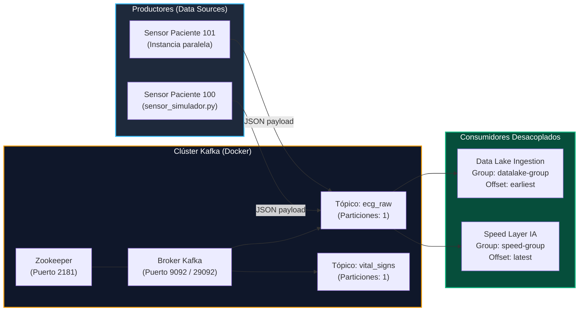

# 02. Fuente de Datos y Bus de Mensajería (Kafka)

Este documento describe la capa de ingestión y origen de la telemetría cardíaca: desde la lectura del dataset médico real hasta el bus de mensajería distribuido con **Apache Kafka**.

---

## 1. El Dataset Clínico MIT-BIH Arrhythmia Database

Para garantizar que el sistema no trabaje con datos sintéticos aleatorios, el proyecto utiliza registros reales del **MIT-BIH Arrhythmia Database**, un estándar de referencia internacional mantenido por *PhysioNet* y el *Beth Israel Deaconess Medical Center*.

### Estructura de Archivos Clínicos (`data/raw/`)
El dataset reside en la carpeta `data/raw/` y utiliza el formato biomédico **WFDB** (*Waveform Database*):

| Archivo | Tipo | Propósito |
| :--- | :--- | :--- |
| **`100.dat`** | Binario | Señal de voltaje digitalizada multiplexada (dos canales de derivación ECG). |
| **`100.hea`** | Texto / Cabecera | Metadatos clínicos: frecuencia de muestreo (360 Hz), resolución del convertidor analógico-digital (200 ADC units/mV) y formato de calibración. |
| **`100.atr`** | Binario | Anotaciones clínicas realizadas por cardiólogos expertos (marcas de latidos normales vs arritmias como extrasístoles ventriculares). |
| **`100.xws`** | Texto | Especificación de forma de onda para visores médicos. |

> [!IMPORTANT]
> Esta carpeta (`data/raw/`) representa la **fuente de la verdad física** del proyecto. El script de limpieza [`clean_project.py`](file:///c:/Users/emman/Documents/Proyectos%20Personales/lambda-architecture-/clean_project.py) cuenta con salvaguardas explícitas para **nunca eliminar ni modificar** estos archivos.

### Extracción de la Señal (Derivación Canal 0)
El simulador utiliza la librería médica `wfdb` para extraer la primera derivación (Canal 0, correspondiente a la derivación torácica modificada MLII, donde la onda R del complejo QRS es más prominente):

```python
import wfdb

record = wfdb.rdrecord('data/raw/100')
signals = record.p_signal[:, 0]  # Array 1D de valores de voltaje en milivoltios (mV)
```

---

## 2. El Simulador de Sensor IoT (`data_sources/sensor_simulador.py`)

El simulador emula el comportamiento de un monitor de signos vitales hospitalario conectado a la red.

### Características Principales:
1. **Flujo Continuo Ininterrumpido:** Implementa un bucle infinito que cicla la señal de ECG sin detenerse, permitiendo pruebas de estrés prolongadas de la arquitectura.
2. **Escalabilidad Multi-Paciente:** Acepta el identificador de paciente como parámetro (`patient_id`), permitiendo levantar $N$ terminales o subprocesos concurrentes para simular una sala de urgencias completa.
3. **Frecuencia y Cadencia de Envío:** Envía muestras cada 10 ms (`time.sleep(0.01)`), simulando una frecuencia de muestreo de **100 Hz** en tiempo real.
4. **Esquema de Eventos JSON:**
   Cada latido se serializa en un mensaje JSON estructurado con el siguiente formato:

```json
{
  "patient_id": "PACIENTE-100",
  "ecg_value": -0.145,
  "timestamp": "2026-09-08T14:30:00.123456"
}
```

---

## 3. Arquitectura del Bus de Mensajería (Kafka + Zookeeper)

Para desacoplar la generación de datos de los múltiples consumidores (Data Lake y Detector de Arritmias), se utiliza **Apache Kafka** orquestado mediante Docker Compose.

### Diagrama de la Topología de Mensajería:



### Configuración de Red y Advertised Listeners (`docker-compose.yml`)

Para permitir que tanto los contenedores internos como los scripts de Python locales en el host se comuniquen con Kafka, se configuran dos listeners:

```yaml
environment:
  KAFKA_BROKER_ID: 1
  KAFKA_ZOOKEEPER_CONNECT: zookeeper:2181
  KAFKA_ADVERTISED_LISTENERS: PLAINTEXT://kafka:29092,PLAINTEXT_HOST://localhost:9092
  KAFKA_LISTENER_SECURITY_PROTOCOL_MAP: PLAINTEXT:PLAINTEXT,PLAINTEXT_HOST:PLAINTEXT
  KAFKA_INTER_BROKER_LISTENER_NAME: PLAINTEXT
  KAFKA_OFFSETS_TOPIC_REPLICATION_FACTOR: 1
```

- **`PLAINTEXT://kafka:29092`:** Usado para comunicación interna entre contenedores dentro de la red Docker (`init-kafka`, etc.).
- **`PLAINTEXT_HOST://localhost:9092`:** Expuesto al puerto del host (`9092:9092`) para que los scripts locales de Python (`sensor_simulador.py`, `raw_to_datalake.py`, `anomaly_detector.py`) se conecten directamente.

### Creación Automática de Tópicos (`init-kafka`)
El servicio `init-kafka` en `docker-compose.yml` automatiza la inicialización de los canales requeridos al arrancar:

```bash
kafka-topics --create --topic vital_signs --bootstrap-server kafka:29092 --partitions 1 --replication-factor 1 --if-not-exists
kafka-topics --create --topic ecg_raw --bootstrap-server kafka:29092 --partitions 1 --replication-factor 1 --if-not-exists
```

---

## 4. Patrón de Doble Consumo (Bifurcación Lambda)

Kafka es el punto donde la arquitectura se bifurca exactamente según el diseño Lambda:

1. **Consumidor A (`streaming/raw_to_datalake.py`):**
   - **Propósito:** Persistir en el Data Lake.
   - **Estrategia:** `auto_offset_reset='earliest'`.
   - **Comportamiento:** Si el consumidor se apaga durante 2 horas, al reconectarse lee desde el último offset guardado y recupera **todos los datos no leídos sin perder ninguno**.

2. **Consumidor B (`streaming/anomaly_detector.py`):**
   - **Propósito:** Alertar al médico en tiempo real.
   - **Estrategia:** `auto_offset_reset='latest'`.
   - **Comportamiento:** Si el detector se reinicia, no pierde tiempo procesando horas de latidos viejos del pasado; se sitúa inmediatamente en el **último latido que acaba de ocurrir** para emitir alertas en el presente.
