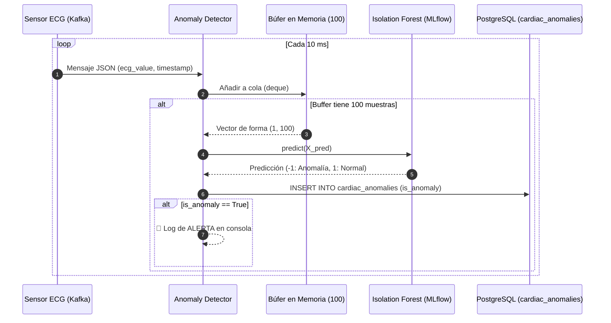

# 03. Speed Layer y Detección de Anomalías con Inteligencia Artificial

Este documento describe la **Speed Layer** (Capa de Velocidad), encargada de la inferencia de Machine Learning de ultra-baja latencia y la emisión de alertas cardíacas en tiempo real.

---

## 1. El Rol de la Speed Layer en la Arquitectura Lambda

La Speed Layer tiene como único objetivo **minimizar la latencia**. A diferencia de la Batch Layer (que analiza días completos de datos en reposo), la Speed Layer opera sobre datos en vuelo (*data in flight*), procesando evento por evento tan pronto como se publica en Kafka.

### Requisitos Técnicos de la Capa:
- **Latencia de procesamiento:** $< 15\text{ ms}$ por inferencia.
- **Política de consumo:** `auto_offset_reset='latest'` (prioriza el presente sobre el pasado).
- **Procesamiento contextual:** Un solo punto de voltaje aislado no indica una arritmia; se requiere una secuencia temporal consecutiva para reconocer la morfología de la onda P-QRS-T.

---

## 2. Ventana Deslizante en Memoria (Sliding Window Buffer)

Un electrocardiograma clínico se compone de ondas bien definidas: la onda P (despolarización auricular), el complejo QRS (despolarización ventricular) y la onda T (repolarización ventricular). 

Para que el modelo de IA reconozca una alteración morfológica (como una contracción ventricular prematura), no podemos evaluarlo punto a punto. Se implementa un **búfer en memoria por paciente**:

```python
# En streaming/anomaly_detector.py
WINDOW_SIZE = 100  # 100 muestras consecutivas (~1 segundo a 100 Hz)
patient_buffers = defaultdict(lambda: deque(maxlen=WINDOW_SIZE))
```

### Mecánica de Inferencia:
1. Conforme llegan los mensajes desde el tópico `ecg_raw`, el valor de voltaje se añade a la cola del paciente (`patient_buffers[patient_id].append(val)`).
2. Cuando la cola alcanza exactamente las **100 muestras**, se transforma en un vector dimensional `(1, 100)`:
   $$\mathbf{X}_{\text{pred}} = [v_{t-99}, v_{t-98}, \dots, v_{t-1}, v_t]$$
3. El vector se entrega al modelo de Machine Learning para emitir la predicción.



---

## 3. Algoritmo de Inteligencia Artificial: Isolation Forest

Para la detección de anomalías se utiliza **Isolation Forest** (*Bosque de Aislamiento*), un algoritmo no supervisado desarrollado por Fei Tony Liu, Kai Ming Ting y Zhi-Hua Zhou.

### ¿Por qué Isolation Forest y no un clasificador tradicional (SVM, Random Forest)?
1. **Desbalance extremo de clases:** En un paciente monitoreado, el 99% o más de los latidos son normales. Los clasificadores supervisados sufren severamente con este nivel de desbalance.
2. **Naturaleza del algoritmo:** En lugar de aprender qué es un latido normal perfilando densidades complejas, Isolation Forest "aísla" las observaciones anómalas:
   - Las anomalías son pocas y tienen valores morfológicos diferentes.
   - Al construir árboles de decisión binarios aleatorios, los puntos anómalos quedan aislados cerca de la raíz del árbol (requieren **menos particiones** para separarse del resto).
3. **Velocidad de Inferencia:** Requiere muy pocas operaciones aritméticas por predicción, permitiendo evaluar cientos de latidos por segundo en CPU sin necesidad de GPUs.

### Hiperparámetros de Entrenamiento (`batch/train_model.py`):
```python
from sklearn.ensemble import IsolationForest

model = IsolationForest(
    contamination=0.01,  # Proporción esperada de anomalías (1% del dataset)
    random_state=42      # Semilla para reproducibilidad
)
model.fit(X)             # X tiene forma (N_ventanas, 100)
```

- **Salida del Modelo:**
  - `+1`: Comportamiento cardíaco normal (`is_anomaly = False`).
  - `-1`: Arritmia o morfología anómala detectada (`is_anomaly = True`).

---

## 4. Registro y Gestión del Ciclo de Vida con MLflow

El proyecto integra **MLflow** para resolver el desacoplamiento entre el entrenamiento de IA y el consumo en producción (MLOps).

```
MLflow Tracking Server: http://localhost:5001
Experimento: Deteccion_Arritmias_ECG_V1
Modelo Registrado: model_ecg
```

### 1. Registro del Modelo (`batch/train_model.py`):
Cuando el ingeniero de datos o científico de datos entrena un nuevo modelo, se registra en el almacén de modelos centralizado:

```python
mlflow.sklearn.log_model(
    sk_model=model, 
    artifact_path="model_ecg",
    registered_model_name="model_ecg" 
)
```

### 2. Carga Dinámica en la Speed Layer (`streaming/anomaly_detector.py`):
El detector en tiempo real nunca busca un archivo `.pkl` rígido en el disco local. Consulta la API de MLflow para descargar automáticamente la **última versión aprobada**:

```python
client = mlflow.tracking.MlflowClient()
latest_version = client.get_latest_versions("model_ecg", stages=["None", "Production"])[0].version
model_uri = f"models:/model_ecg/{latest_version}"
model = mlflow.sklearn.load_model(model_uri)
```

> [!TIP]
> Si en el futuro entrenas un modelo mejorado (por ejemplo, con más pacientes o una red neuronal), solo ejecutas `train_model.py`. Al reiniciar el detector, cargará la nueva versión automáticamente sin cambiar una sola línea de código del consumidor de streaming.

---

## 5. Persistencia en la Serving Layer (PostgreSQL)

Cada inferencia se registra de inmediato en la tabla `cardiac_anomalies` de PostgreSQL:

```sql
CREATE TABLE IF NOT EXISTS cardiac_anomalies (
    id SERIAL PRIMARY KEY,
    patient_id VARCHAR(50),
    timestamp TIMESTAMP,
    ecg_value FLOAT,
    is_anomaly BOOLEAN
);
```

- Esta tabla alimenta directamente:
  1. El endpoint de FastAPI `/realtime`.
  2. El panel de alta frecuencia de **Grafana** (donde los puntos con `is_anomaly = true` se pintan de color rojo brillante).
