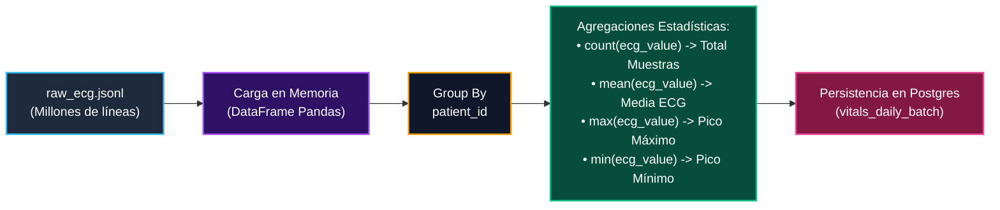

# 04. Batch Layer y Master Dataset (Data Lake)

Este documento describe la **Batch Layer** (Capa por Lotes): el pilar de la Arquitectura Lambda encargado de custodiar la verdad inmutable y calcular resúmenes estadísticos completos y precisos.

---

## 1. El Concepto de Master Dataset e Inmutabilidad

En la arquitectura Lambda, los datos crudos que ingresan al sistema representan hechos históricos comprobables que ocurrieron en un instante de tiempo. Por definición, **un hecho histórico no se puede modificar ni borrar; solo se puede registrar**.

### Propiedades del Master Dataset:
1. **Inmutabilidad Absoluta:** Los archivos nunca se abren en modo de sobrescritura (`'w'`), sino exclusivamente en modo de adición (*Append-Only*, `'a'`).
2. **Formato JSON Lines (`.jsonl`):** Cada evento es un objeto JSON autónomo separado por un salto de línea (`\n`). Si una línea se corrompe por una caída súbita de energía, las millones de líneas anteriores y posteriores permanecen legibles e intactas.
3. **Resiliencia ante Cambios de Lógica de Negocio:** Si en 6 meses los cardiólogos deciden calcular la "Varianza del Intervalo RR", no es necesario haber guardado esa métrica en tiempo real: simplemente se ejecuta un script sobre el Data Lake histórico y se recalculan todos los meses pasados.

---

## 2. Ingesta Persistente al Data Lake (`streaming/raw_to_datalake.py`)

El script de ingesta es un consumidor de Kafka diseñado con tolerancia total a fallos:

```python
# En streaming/raw_to_datalake.py
consumer = KafkaConsumer(
    TOPIC_INPUT,
    bootstrap_servers=[KAFKA_BROKER],
    value_deserializer=lambda m: json.loads(m.decode('utf-8')),
    auto_offset_reset='earliest',  # <--- CRÍTICO: Nunca pierde eventos
    enable_auto_commit=True,
    group_id='datalake-group'      # Recuerda el progreso de lectura
)
```

### ¿Por qué `auto_offset_reset='earliest'`?
A diferencia de la Speed Layer (que solo atiende el presente con `'latest'`), la Batch Ingest debe garantizar que ningún latido transmitido por los sensores se quede sin archivar. Si el script de Data Lake se detiene por mantenimiento o fallas de red durante 3 horas, al reiniciar **descarga todos los mensajes pendientes desde donde se quedó** y los escribe en el archivo correspondiente.

### Particionado Cronológico Diario:
El Data Lake organiza el almacenamiento en particiones jerárquicas por fecha:

```text
data/
└── datalake/
    ├── 2026-09-04/
    │   └── raw_ecg.jsonl
    ├── 2026-09-07/
    │   └── raw_ecg.jsonl
    └── 2026-09-08/
        └── raw_ecg.jsonl
```

- Cada día nuevo genera automáticamente su propia carpeta (`os.path.join(DATALAKE_BASE, today_str)`).
- Esto permite al procesador por lotes leer exactamente los días solicitados sin escanear el almacenamiento completo (*partition pruning*).

---

## 3. Procesamiento Masivo con Pandas (`batch/batch_daily_processor.py`)

El procesador por lotes representa el *Heavy Lifting* analítico. Se encarga de procesar millones de registros sin las restricciones de latencia de la Speed Layer.

### Algoritmo de Agregación:



### Código de Agregación con Pandas:
```python
# 1. Agrupación por paciente y cálculo de métricas
resumen = df.groupby('patient_id').agg(
    total_muestras=('ecg_value', 'count'),
    promedio_ecg=('ecg_value', 'mean'),
    max_ecg=('ecg_value', 'max'),
    min_ecg=('ecg_value', 'min')
).reset_index()
```

### Tabla de Destino en PostgreSQL (`vitals_daily_batch`):
```sql
CREATE TABLE IF NOT EXISTS vitals_daily_batch (
    fecha DATE,
    patient_id VARCHAR(50),
    total_muestras INT,
    promedio_ecg FLOAT,
    max_ecg FLOAT,
    min_ecg FLOAT,
    PRIMARY KEY (fecha, patient_id)
);
```

> [!NOTE]
> La clave primaria compuesta `(fecha, patient_id)` asegura que el proceso batch sea **idempotente**: si el proceso se ejecuta dos veces en el mismo día, un `ON CONFLICT (fecha, patient_id) DO UPDATE` actualiza los valores sin duplicar filas.

---

## 4. Orquestación Automatizada (`batch/scheduler.py`)

En un hospital real, el procesamiento por lotes se ejecuta una vez al día (usualmente a la medianoche, mediante herramientas como Apache Airflow, cron jobs o Celery) cuando los servidores tienen menor carga de red.

Para propósitos de demostración interactiva y pruebas de la arquitectura, `batch/scheduler.py` ejecuta un bucle continuo configurable (por defecto cada 60 segundos):

```python
INTERVALO_SEGUNDOS = 60

def iniciar_scheduler():
    while True:
        ejecutar_batch_processor()
        time.sleep(INTERVALO_SEGUNDOS)
```

- Cada ciclo procesa el Data Lake del día actual, calcula las nuevas muestras acumuladas y actualiza la tabla `vitals_daily_batch`.
- Así, tanto Grafana como la API REST siempre tienen disponible el resumen histórico más reciente.
