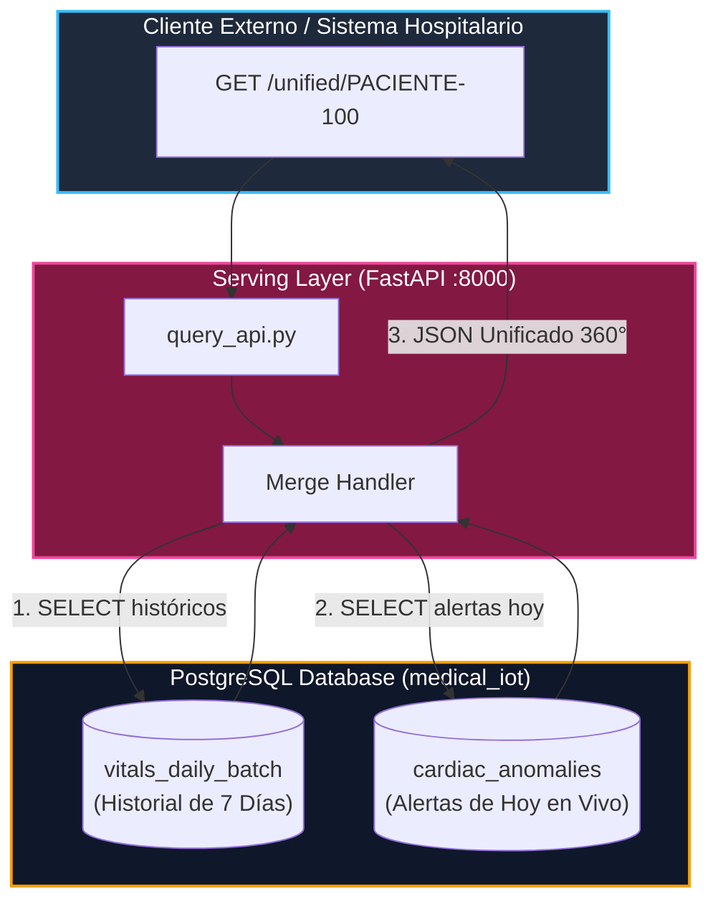

# 05. Serving Layer y API RESTful (FastAPI)

Este documento describe la **Serving Layer** (Capa de Servicio): la interfaz de consulta responsable de responder peticiones analíticas a aplicaciones médicas, sistemas de monitoreo y expedientes clínicos electrónicos.

---

## 1. El Rol de la Serving Layer y el Patrón "Merge Lambda"

En la Arquitectura Lambda, la Serving Layer cumple dos objetivos fundamentales:
1. **Desacoplamiento de Lectura/Escritura:** Protege las bases de datos de streaming y los almacenes de datos brutos de consultas externas pesadas.
2. **El "Merge" (Fusión de Vistas):** Los clientes (médicos, enfermeras o sistemas externos) no deben preocuparse por si un dato provino de un streaming de hace 5 segundos o de un lote de hace 3 días; la Serving Layer fusiona ambas realidades de forma transparente:

$$\text{Vista Clínica Unificada} = \text{Tendencia Histórica (Batch)} \oplus \text{Alertas Críticas Hoy (Speed)}$$



---

## 2. Implementación de la API con FastAPI (`serving/query_api.py`)

La API está construida con **FastAPI** y se ejecuta en el puerto `8000` mediante el servidor ASGI **Uvicorn**.

### Catálogo Completo de Endpoints:

| Método | Endpoint | Capa Consultada | Descripción |
| :--- | :--- | :--- | :--- |
| `GET` | `/` | Sistema | Mensaje de bienvenida y enlace a Swagger UI. |
| `GET` | `/realtime` | **Speed Layer** | Retorna las últimas $N$ anomalías detectadas en vivo (`cardiac_anomalies`). Parámetro `limit` (default: 50). |
| `GET` | `/batch` | **Batch Layer** | Retorna los últimos $N$ resúmenes diarios procesados históricamente (`vitals_daily_batch`). Parámetro `limit` (default: 10). |
| `GET` | `/summary` | **Híbrido** | Resumen ejecutivo con el conteo total de anomalías en tiempo real y el total de días históricos procesados. |
| `GET` | `/unified/{patient_id}` | **Merge Lambda** | **Endpoint estrella:** Fusiona la tendencia histórica de 7 días del paciente con sus anomalías del día actual. |

---

## 3. Análisis Profundo del Endpoint Unificado (`/unified/{patient_id}`)

Este endpoint materializa la esencia de la arquitectura Lambda en el código:

```python
@app.get("/unified/{patient_id}")
def get_unified_view(patient_id: str):
    conn = get_db_connection()
    cur = conn.cursor(cursor_factory=RealDictCursor)
    
    try:
        # 1. BATCH VIEW (Precisión Histórica - Últimos 7 días)
        cur.execute("""
            SELECT fecha, total_muestras, promedio_ecg, max_ecg, min_ecg 
            FROM vitals_daily_batch 
            WHERE patient_id = %s 
            ORDER BY fecha DESC LIMIT 7
        """, (patient_id,))
        batch_history = cur.fetchall()

        # 2. REAL-TIME VIEW (Inmediatez / Speed Layer - Alertas críticas de HOY)
        today_str = date.today().isoformat()
        cur.execute("""
            SELECT timestamp, ecg_value 
            FROM cardiac_anomalies 
            WHERE patient_id = %s 
              AND is_anomaly = true 
              AND DATE(timestamp) = %s
            ORDER BY timestamp DESC LIMIT 20
        """, (patient_id, today_str))
        realtime_alerts = cur.fetchall()

        # 3. MERGE (Fusión de ambas capas)
        return {
            "patient_id": patient_id,
            "architecture_principle": "Lambda Merge (Batch Precision + Speed Immediacy)",
            "clinical_view": {
                "historical_trend_batch": batch_history,
                "critical_alerts_today_speed": realtime_alerts
            }
        }
    finally:
        cur.close()
        conn.close()
```

### Ejemplo de Respuesta JSON del Merge Lambda:

```json
{
  "patient_id": "PACIENTE-100",
  "architecture_principle": "Lambda Merge (Batch Precision + Speed Immediacy)",
  "clinical_view": {
    "historical_trend_batch": [
      {
        "fecha": "2026-09-08",
        "total_muestras": 51004,
        "promedio_ecg": -0.3293,
        "max_ecg": 1.125,
        "min_ecg": -0.695
      },
      {
        "fecha": "2026-09-07",
        "total_muestras": 1193078,
        "promedio_ecg": -0.3060,
        "max_ecg": 1.435,
        "min_ecg": -2.715
      }
    ],
    "critical_alerts_today_speed": [
      {
        "timestamp": "2026-09-08T14:32:15.120000",
        "ecg_value": 1.2550
      },
      {
        "timestamp": "2026-09-08T14:32:14.980000",
        "ecg_value": -0.5750
      }
    ]
  }
}
```

---

## 4. Documentación Interactiva Swagger / OpenAPI

FastAPI autogenera especificaciones interactivas OpenAPI para que médicos e ingenieros prueben los endpoints directamente en el navegador:

- **Swagger UI:** [http://localhost:8000/docs](http://localhost:8000/docs)
- **ReDoc:** [http://localhost:8000/redoc](http://localhost:8000/redoc)

---

## 5. Esquema Relacional de Base de Datos y Optimización

Las tablas en PostgreSQL están diseñadas para soportar lecturas rápidas de la Serving Layer:

```sql
-- 1. Tabla de la Speed Layer (Alertas y latidos en vivo)
CREATE TABLE IF NOT EXISTS cardiac_anomalies (
    id SERIAL PRIMARY KEY,
    patient_id VARCHAR(50) NOT NULL,
    timestamp TIMESTAMP NOT NULL,
    ecg_value FLOAT NOT NULL,
    is_anomaly BOOLEAN NOT NULL
);

-- Índices recomendados para optimizar consultas de tiempo real:
CREATE INDEX IF NOT EXISTS idx_cardiac_patient_time 
ON cardiac_anomalies (patient_id, timestamp DESC);

CREATE INDEX IF NOT EXISTS idx_cardiac_anomalies_only 
ON cardiac_anomalies (patient_id, timestamp DESC) 
WHERE is_anomaly = true;

-- 2. Tabla de la Batch Layer (Resúmenes diarios)
CREATE TABLE IF NOT EXISTS vitals_daily_batch (
    fecha DATE NOT NULL,
    patient_id VARCHAR(50) NOT NULL,
    total_muestras INT NOT NULL,
    promedio_ecg FLOAT NOT NULL,
    max_ecg FLOAT NOT NULL,
    min_ecg FLOAT NOT NULL,
    PRIMARY KEY (fecha, patient_id)
);
```
