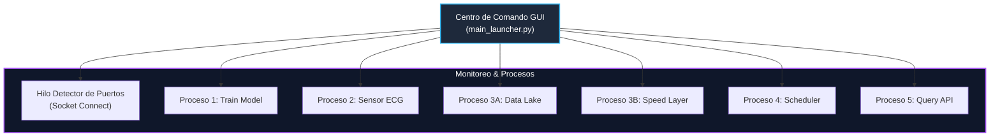

# 07. Guía de Operación y Solución de Fallos (Troubleshooting)

Este documento detalla los procedimientos operativos para ejecutar, reiniciar y depurar la arquitectura completa, tanto a través del centro de comando gráfico como mediante terminales independientes.

---

## 1. Método A: Ejecución mediante el Centro de Comando Gráfico (`main_launcher.py`)

Para facilitar el control unificado de todos los procesos concurrentes, el proyecto incluye un centro de control desarrollado con Python y **Tkinter**:

```powershell
python main_launcher.py
```

### Arquitectura Interna del Launcher:
- **Monitoreo de Infraestructura en Segundo Plano:** Un hilo (*daemon thread*) sondea cada 2 segundos los puertos `9092` (Kafka), `5432` (PostgreSQL), `5001` (MLflow) y `8000` (FastAPI), actualizando indicadores LED de color verde/rojo en tiempo real.
- **Subprocesos Asíncronos Desacoplados:** Cada módulo se ejecuta en su propio subproceso mediante `subprocess.Popen` sin bloquear la interfaz gráfica.
- **Cola de Mensajes Thread-Safe:** Se utiliza `queue.Queue()` para canalizar las salidas estándar (*stdout* y *stderr*) de cada script a su propia consola interactiva.
- **Contador en Vivo de Telemetría:** Parsea automáticamente las emisiones del sensor para mostrar el contador de latidos transmitidos y anomalías detectadas en la barra superior.



---

## 2. Método B: Ejecución Desacoplada por Terminales Independientes

Si prefieres operar cada componente por separado para depurar logs con mayor detalle:

### Paso 1: Levantar los Servicios en Docker
```powershell
docker-compose up -d
```
*Espera unos 30 segundos a que Kafka termine de estabilizar sus brokers y Zookeeper elija el controlador.*

### Paso 2: Entrenar el Modelo Base (MLflow)
```powershell
python batch/train_model.py
```
*Asegúrate de ver: `✅ Modelo entrenado y registrado en MLflow como 'model_ecg'`.*

### Paso 3: Levantar la Capa de Servicio (Serving API)
*(En una terminal nueva con el venv activado)*
```powershell
python serving/query_api.py
```
*Estará disponible en `http://localhost:8000`.*

### Paso 4: Iniciar el Flujo de Datos y la Bifurcación
Abre 4 terminales independientes y ejecuta en este orden:

```powershell
# Terminal 1: Ingesta al Data Lake (Master Dataset inmutable)
python streaming/raw_to_datalake.py

# Terminal 2: Speed Layer (Detección de anomalías con IA)
python streaming/anomaly_detector.py

# Terminal 3: Fuente de Datos (Emisor continuo de latidos a Kafka)
python data_sources/sensor_simulador.py

# Terminal 4: Orquestador Batch (Cálculo periódico de resúmenes)
python batch/scheduler.py
```

---

## 3. Limpieza Total y Reset del Proyecto (`clean_project.py`)

Para restablecer el sistema a su estado original (como si se acabara de clonar el repositorio) sin necesidad de tocar Docker:

```powershell
# Modo interactivo con confirmación de seguridad
python clean_project.py

# Modo desatendido directo
python clean_project.py -y

# Conservar los modelos entrenados en MLflow
python clean_project.py --skip-mlflow
```

### Componentes que Limpia:
1. **Data Lake (`data/datalake/`):** Elimina todas las carpetas diarias y archivos `.jsonl`.
2. **PostgreSQL:** Trunca a 0 filas las tablas `cardiac_anomalies` y `vitals_daily_batch`.
3. **MLflow (`batch/`):** Elimina `batch/mlruns/` y `batch/mlflow.db`.
4. **Kafka:** Purga y recrea los tópicos `ecg_raw` y `vital_signs` con offsets en 0.
5. **Cachés:** Elimina carpetas `__pycache__` y archivos `.pyc`.
6. **Protección:** Verifica que el dataset original en `data/raw/` permanezca intacto.

---

## 4. Matriz de Solución de Errores Reales (Troubleshooting)

A continuación se documentan los errores técnicos específicos que se han presentado en el entorno y su solución validada:

| Error / Síntoma | Causa Raíz Técnica | Solución Definitiva |
| :--- | :--- | :--- |
| `ValueError: Invalid file descriptor: -1` | **Incompatibilidad de Python 3.12 con sockets cerrados:** La librería `kafka-python-ng` intenta desregistrar del selector de eventos un socket que ya fue cerrado por Kafka durante el handshake de arranque. En Python 3.12, `selectors.py` valida rigurosamente los descriptores y lanza `ValueError` si el fd es `-1`. | Se aplicó un parche en `kafka/client_async.py` (líneas 638-645) para capturar `ValueError` además de `KeyError` y continuar la iteración si el socket ya está cerrado. |
| Grafana muestra **`No data`** en la gráfica de ECG | **Desfase de 6 Horas de Huso Horario:** Python genera la fecha con `datetime.now()` (hora local de México, UTC-6) y la guarda como `TIMESTAMP` plano en PostgreSQL. Grafana interpreta los timestamps sin zona horaria como **UTC**, por lo que le restaba 6 horas al graficarlos en el navegador (quedando fuera de la ventana *"Last 5 minutes"*). | Cambiar la consulta SQL en Grafana para forzar la conversión de zona horaria: `SELECT (timestamp AT TIME ZONE 'America/Mexico_City') AS "time" ...` |
| `NoBrokersAvailable` al iniciar scripts de Kafka | El contenedor de Kafka aún se encuentra en su fase de inicialización interna o creación de tópicos con Zookeeper (suele tardar entre 15 y 30 segundos). | Esperar 30 segundos tras ejecutar `docker-compose up -d`. Verificar en Docker Desktop que el contenedor `lambda-architecture--kafka-1` esté en verde. |
| `UnicodeEncodeError: 'charmap' codec can't encode character` | La consola de comandos estándar de Windows (PowerShell/CMD) usa por defecto la codificación heredada `cp1252`, la cual no soporta emojis ni caracteres UTF-8 extendidos. | Añadir al inicio del script: `sys.stdout.reconfigure(encoding='utf-8', errors='replace')` o ejecutar mediante el launcher gráfico. |
| La tabla Batch en Grafana muestra la fecha con un día de retraso | Se utilizó el alias `fecha AS "time"`. Al llamarse `"time"`, Grafana lo trata como timestamp medianoche en UTC y al restarle las 6 horas de México lo proyecta a las 18:00 del día anterior. | Renombrar la columna a `fecha AS "Fecha"` y usar el tipo de panel **Table**. |
| `MLflow 404 / Connection Error` | Conflicto en el puerto de MLflow entre el puerto interno del contenedor (`5000`) y el expuesto al host (`5001`). | Asegurarse de que `docker-compose.yml` mapee `"5001:5000"` y que el archivo `.env` declare `MLFLOW_URI=http://localhost:5001`. |
