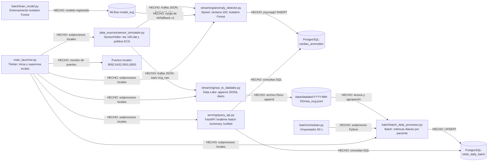
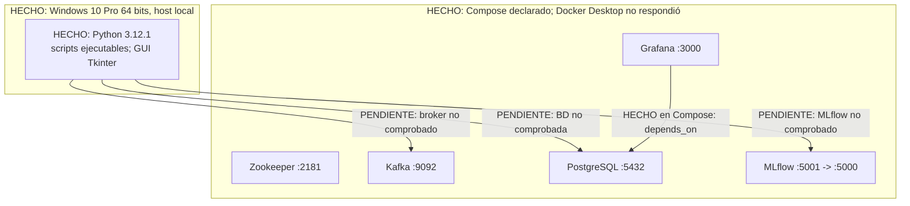
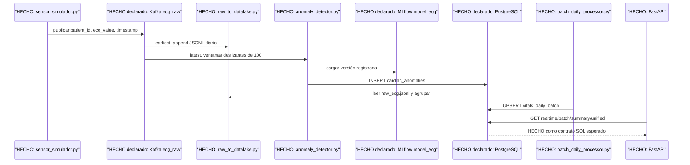

# Avance del sábado · propuesta de mejora y arquitectura inicial

> **Objetivo:** dejar listo un cambio pequeño y verificable para implementar la próxima semana. No se espera entregar aquí la mejora terminada. La propuesta siguiente es una opción sustentada por evidencia; no se eligió ni implementó ninguna mejora.

## 1. Identificación y estado de partida

| Dato | Información |
|---|---|
| Nombre | Diego Ignacio Garcia Diaz de Leon |
| Grupo/equipo | PENDIENTE: no está confirmado en el repositorio. |
| Repositorio/ruta de trabajo | https://github.com/EldiegoGDL/Implementaci-n-de-Lambda |
| Rama y commit inicial | HECHO: rama `agente`; commit `08bb8100315bd99315f0f66ce3b24c83d67a2de5`; sujeto `incorporacion del agente reintento 2`; seguimiento de `origin/agente`. |
| Sistema operativo y versión | HECHO: Microsoft Windows 10 Pro, versión `10.0.19045`, compilación `19045`, arquitectura `64 bits`. |
| Agente y forma de acceso | HECHO: Copilot SDK usado dentro de VS Code, con terminal PowerShell local y herramientas de lectura/ejecución. |
| Cambios locales previos a conservar | HECHO: antes de esta redacción, `git status --short --branch` no mostró archivos modificados ni sin seguimiento. Por tanto, no había cambios locales previos que sobrescribir. |

## 2. Arquitectura actual antes del cambio

Los diagramas representan únicamente módulos y relaciones observados en el commit evaluado.

### Vista estática · módulos, responsabilidades e interfaces

**Evidencia en archivos/funciones:**  
- **HECHO:** el simulador usa `wfdb.rdrecord('data/raw/100')`, publica `patient_id`, `ecg_value` y `timestamp` a Kafka y recicla el archivo al final (`data_sources/sensor_simulador.py`).  
- **HECHO:** el ingestor usa `auto_offset_reset='earliest'`, escribe JSONL por fecha y posee `group_id='datalake-group'` (`streaming/raw_to_datalake.py`).  
- **HECHO:** el detector mantiene `deque(maxlen=100)` por paciente, carga el modelo MLflow y escribe en `cardiac_anomalies` (`streaming/anomaly_detector.py`).  
- **HECHO:** el proceso diario agrupa por `patient_id` y hace UPSERT en `vitals_daily_batch` (`batch/batch_daily_processor.py`).  
- **HECHO:** el scheduler ejecuta el procesador cada 60 segundos (`batch/scheduler.py`).  
- **HECHO:** FastAPI expone rutas reales de consulta; `/unified/{patient_id}` combina ambas tablas (`serving/query_api.py`).  
- **HECHO:** la GUI Tkinter inicia los seis scripts como subprocesos y supervisa puertos (`main_launcher.py`).  
- **HECHO:** Docker Compose define Kafka, Zookeeper, PostgreSQL, Grafana y MLflow (`docker-compose.yml`).  

**Pendientes:** confirmar ejecución real de servicios, contenido de una base PostgreSQL, registros existentes en MLflow y creación efectiva de archivos bajo `data/datalake/`. No se encontraron `.env`, `data/datalake/`, `batch/mlflow.db` ni `batch/mlruns/` en el árbol real.

### Vista física · entornos y despliegue

**Dónde se ejecuta cada elemento y evidencia:**  
- **HECHO:** Docker CLI disponible como Docker `29.2.1` y Docker Compose `v5.1.0`.  
- **HECHO:** el daemon Docker no estaba disponible: `docker ps --format 'table {{.Names}}\t{{.Image}}\t{{.Status}}\t{{.Ports}}'` devolvió `failed to connect to the docker API at npipe:////./pipe/dockerDesktopLinuxEngine; ... El sistema no puede encontrar el archivo especificado.`  
- **HECHO:** las comprobaciones TCP a `localhost:9092`, `5432`, `5001`, `8000` y `3000` dieron `False`.  
- **HECHO:** no existe `.env`; `.env.example` declara credenciales PostgreSQL distintas de los valores reales usados por Compose.  

**Pendientes:** confirmar si Docker Desktop está instalado pero detenido, si Python 3.12.1 pertenece a un entorno virtual y si los contenedores arrancarían sin ajustes. La versión exacta de shell interactiva no fue capturada.

### Vista dinámica · recorrido de un escenario existente

**Escenario:** desde el simulador hasta la vista unificada FastAPI.

**Resultado esperado:** según código/documentación, el sensor publica muestras en `ecg_raw`; el ingestor las persiste; el detector carga el modelo, mantiene ventanas por paciente y escribe alertas; el batch agrega el día; FastAPI mezcla resúmenes y alertas actuales.

**Evidencia y resultado observado:**  
- **HECHO:** `python -m compileall -q batch data_sources serving streaming main_launcher.py` finalizó con `compileall: OK`. Esta comprobación valida sintaxis, no ejecuta servicios ni demuestra interoperabilidad.  
- **HECHO:** los archivos MIT-BIH reales `100.dat` y `100.hea` están presentes; `100.xws` y `100.atr` también existen.  
- **HECHO:** no se abrió el flujo end-to-end porque Docker no respondió y los puertos esperados estaban cerrados.  
- **PENDIENTE:** no se observaron logs de Kafka, PostgreSQL, MLflow, FastAPI, ni una respuesta HTTP real.

**Pendientes:** ejecutar el stack completo con Docker Desktop activo, registrar el modelo, iniciar consumidores y sensores, y comprobar al menos una alerta y un resumen diario observables.

## 3. Problema o oportunidad

- **Necesidad concreta:** hacer verificable antes de iniciar los scripts si el entorno local tiene Docker activo, puertos disponibles y variables consistentes con los servicios declarados.
- **Evidencia observada:**  
  - SO: Windows 10 Pro `10.0.19045`, 64 bits.  
  - Comando: `docker ps --format ...`.  
  - Salida: falla de conexión a `npipe:////./pipe/dockerDesktopLinuxEngine`.  
  - Comando: comprobación TCP con `Test-NetConnection` a los puertos `9092`, `5432`, `5001`, `8000` y `3000`.  
  - Resultado observado: todos devolvieron `False`.  
  - HECHO: no existe `.env`, mientras `.env.example` propone `tu_usuario_aqui` y `tu_password_aqui`, que no coinciden con `admin/admin` configurados en Compose.  
- **A quién o qué beneficia:** al estudiante y a quien depura el laboratorio; reduce adivinación y arranque parcial.
- **Por qué importa para este proyecto:** el arranque actual puede generar scripts iniciados sin sus dependencias y errores Kafka/MLflow/DB difíciles de distinguir de fallos internos.
- **Tipo:** configuración, portabilidad y diagnóstico.

## 4. Propuesta de mejora pequeña

- **Qué sí se cambiaría:** una sola comprobación previa no destructiva en el arranque del centro de comandos o como script auxiliar local. Debería informar el estado efectivo de Docker, puertos, `.env` y variables críticas sin iniciar ni limpiar datos.
- **Qué queda fuera:** cambios de tablas, payloads Kafka, topologías Docker, modelo ML, lógica de inferencia, consultas de Grafana, autenticación, despliegue remoto y migraciones.
- **Archivos o componentes que podrían cambiar:** `main_launcher.py`; opcionalmente un módulo auxiliar nuevo. No se propone tocar código hasta que el equipo confirme el alcance.
- **Interfaces, formatos o responsabilidades que se deben conservar:**  
  - **HECHO:** broker `localhost:9092`, topic `ecg_raw`.  
  - **HECHO:** tablas `cardiac_anomalies` y `vitals_daily_batch`; claves y columnas usadas por batch y API.  
  - **HECHO:** rutas HTTP `/`, `/realtime`, `/batch`, `/summary` y `/unified/{patient_id}`.  
  - **HECHO:** modelo registrado `model_ecg` y URI MLflow `http://localhost:5001`.  
  - **HECHO:** nombres de variables `KAFKA_BROKER`, `KAFKA_TOPIC_RAW`, `MLFLOW_URI`, `DB_HOST`, `DB_PORT`, `DB_NAME`, `DB_USER` y `DB_PASSWORD`.  
- **Efecto previsto en la vista estática:** no cambia responsabilidades principales; solo añade una relación opcional de diagnóstico hacia configuración y puertos. Los scripts de datos, batch y serving conservan sus dependencias.
- **Efecto previsto en la vista física:** no despliega nuevos servicios. Hace visible el estado de los servicios existentes, sin cambiar imágenes, volúmenes, puertos ni contenedores.
- **Efecto previsto en la vista dinámica:** antes de arrancar un módulo, el usuario recibe un resultado de preflight. El flujo normal de sensor → Kafka → Lake/Speed → DB → API permanece igual.
- **Riesgo principal y cómo reducirlo:** un diagnóstico podría engañar si sólo prueba puertos. Reducirlo comprobando daemon Docker, puerto, resolución de variables y retorno directo de cada check, sin interpretar cierre de puerto como fallo del proceso salvo que se confirme por artefacto adicional.

### Criterios de aceptación y comprobación

| Criterio observable | Cómo se comprobará | Entorno requerido | Resultado esperado |
|---|---|---|---|
| Docker detenido se informa sin excepción no controlada | Ejecutar el preflight con Docker Desktop detenido | HECHO: Windows 10 Pro 64 bits, Docker CLI 29.2.1 | Mensaje indica daemon no disponible y muestra el comando fallido, sin iniciar scripts ni borrar datos. |
| Puertos cerrados se identifican individualmente | Ejecutar el preflight con el stack detenido | Windows 10 Pro | Estados separados para `9092`, `5432`, `5001`, `8000` y `3000`, todos como cerrados o sin respuesta. |
| Variables placeholders no se aceptan silenciosamente | Crear `.env` temporal con `tu_usuario_aqui`/`tu_password_aqui` y ejecutar el preflight | Proyecto local; no modificar configuraciones previas | El preflight señala valores placeholders como inválidos o exige revisión antes de arrancar. |
| Stack declarado puede pasar el preflight | Ejecutar Docker Compose y levantar stack; luego preflight | Docker Desktop operativo | Solo pasa cada check cuyo puerto esté abierto; el resultado no puede afirmar éxito end-to-end sin respuesta HTTP/BD. |
| Contratos actuales permanecen | Ejecutar búsqueda y pruebas de ruta existentes después del cambio | Python 3.12.1 | Kafka usa `ecg_raw`, MLflow usa `model_ecg`, tablas y rutas HTTP permanecen sin cambios; no hay datos ni modelos eliminados. |

## 5. Decisión y pendientes

- **Propuesta que acuerda implementar el equipo/estudiante:** PENDIENTE: no se tomó una decisión por el agente ni se implementó nada.
- **Motivo de la elección frente a alternativas:** esta alternativa es acotada y aborda el bloqueo observado (Docker/servicios indisponibles y `.env` ausente) sin modificar arquitectura ni datos. PENDIENTE: comparar contra otras propuestas del equipo.
- **Pregunta que se resolverá antes de editar código:** ¿se debe integrar el preflight en `main_launcher.py` o debe ser un script auxiliar independiente conservando el mismo alcance?
- **Siguiente acción concreta para la semana 2:** PENDIENTE de elección del equipo: activar Docker Desktop, ejecutar `docker compose up -d` y observar el estado real de los contenedores antes de implementar.
- **Estimación personal de tiempo disponible:** PENDIENTE.

## 6. Revisión de este avance

- [x] Confirmé rama, commit y cambios que no debo sobrescribir.
- [x] Las vistas describen el sistema actual y tienen evidencia, o señalan claramente lo pendiente.
- [x] El problema está sustentado y no es solamente una idea del agente.
- [ ] La propuesta cabe en el tiempo disponible y tiene exclusiones explícitas.
- [ ] Sé qué pruebas o comprobaciones usaré.
- [x] Sé qué responsabilidades, interfaces o flujos deben preservarse.
